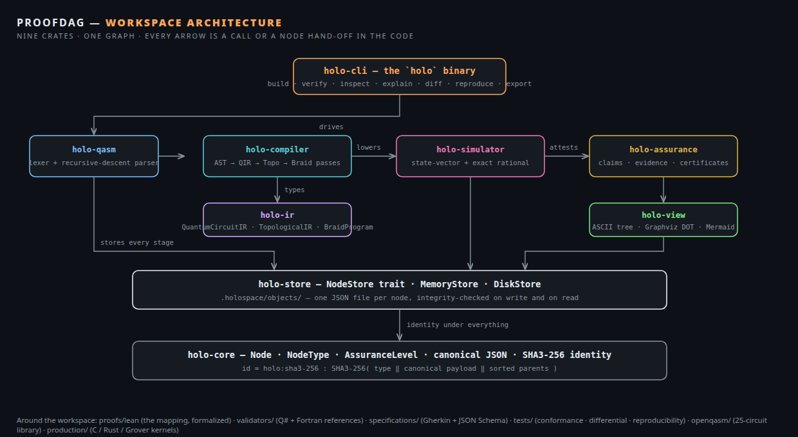
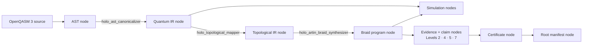
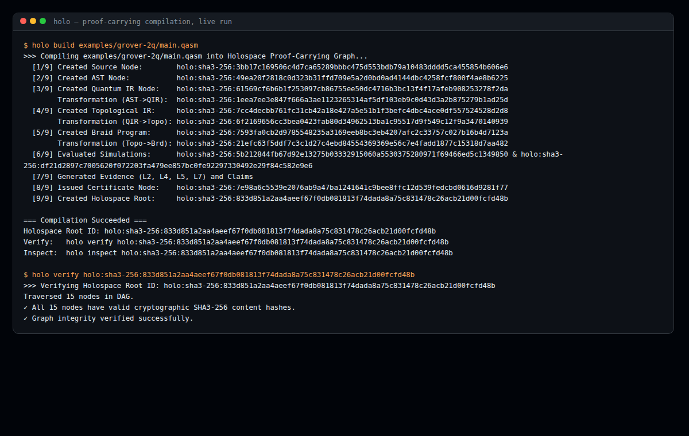
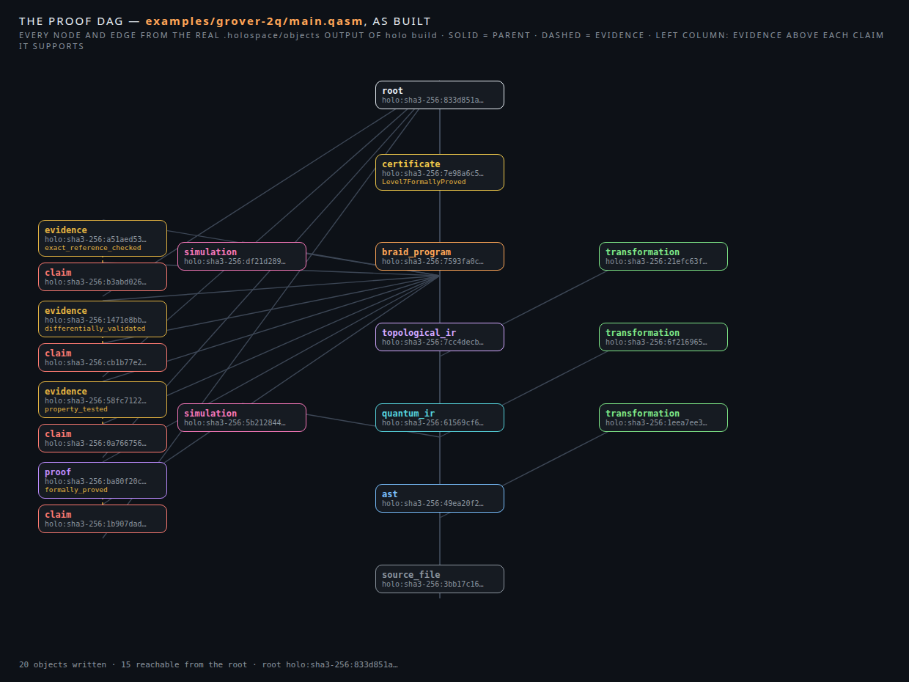

# ProofDag

**Proof-carrying compilation for reproducible quantum software**

[](https://www.gnu.org/licenses/agpl-3.0)
[](https://www.rust-lang.org/)
[](https://lean-lang.org/)

ProofDag is a proof-carrying compilation system for quantum software,
written in Rust as a nine-crate workspace. It takes an OpenQASM 3
program as input and compiles it — through a canonical quantum
intermediate representation, a topological intermediate representation,
and an executable braid program — while recording every step of that
journey as a node in one immutable, content-addressed directed acyclic
graph. The source file is a node. The abstract syntax tree is a node.
Each compiler pass is a node, and so is the record of the pass itself:
which tool ran, at which version, under which configuration, owing
which semantic obligation. Simulation results are nodes. Scientific
claims about the compiled circuit are nodes, and the evidence behind
each claim — a property test, a differential comparison, an exact
rational reference evaluation, a Lean 4 proof artifact — is a node of
its own, linked to the claim it supports. A certificate summarizes the
assurance gathered over a subject, and a root manifest ties the whole
graph together under a single identifier.

The identifier is the point. Every node ID in the graph is a SHA3-256
hash of the node's type, its canonical payload, and its sorted parent
IDs, so the identity of any artifact is a function of exactly what it
contains and exactly what it derives from. Rebuild the same program
and the graph re-derives the same IDs; change one character of the
source and every downstream ID moves. Nothing in the system is
identified by where it happens to be stored, by when it was built, or
by who built it. This README is a walkthrough of the system as it
stands in this repository: what each part is, how the parts connect,
what a compilation actually produces, and where the current boundaries
of the implementation lie.



*The nine crates and the direction of travel between them. The CLI
drives; the compiler lowers; the simulator evaluates; the assurance
layer attests; the store keeps every stage; holo-core defines the
identity that all of them share.*

## The workspace at a glance

The repository is organized as a compilation pipeline with a memory:

| Path | What is there |
| --- | --- |
| `crates/holo-core` | The node model: identity, canonical serialization, node types, assurance levels |
| `crates/holo-store` | Content-addressed storage for nodes, in memory or on disk under `.holospace/objects/` |
| `crates/holo-qasm` | A hand-written lexer and recursive-descent parser for an OpenQASM 3 subset |
| `crates/holo-ir` | The three intermediate representations: quantum, topological, braid |
| `crates/holo-compiler` | The three lowering passes between those representations |
| `crates/holo-simulator` | A state-vector simulator and an exact rational-arithmetic reference |
| `crates/holo-assurance` | Claims, evidence at four assurance levels, certificates, and the root manifest |
| `crates/holo-view` | Renderers: ASCII tree, Graphviz DOT, Mermaid |
| `crates/holo-cli` | The `holo` binary: build, verify, inspect, explain, diff, reproduce, export |
| `proofs/lean` | Lean 4 formalization of the compiler's gate-to-braid mapping |
| `validators` | Independent reference implementations in Q# and Fortran |
| `specifications` | The node contract as a JSON Schema, and the genesis build as a Gherkin feature |
| `tests` | A conformance test, a differential test, and a reproducibility test |
| `examples` | Two runnable programs: a Bell state and the 2-qubit Grover search |
| `openqasm` | A library of 25 OpenQASM circuits, plus the angle file the C kernel reads |
| `production` | Standalone kernels: a C state-vector simulator, and Rust crate manifests for a parser and an exact Grover reference |
| `attic` | A preserved copy of the production tree |
| `docs` | Architecture, the assurance model, mathematical foundations, and the threat model |

Everything the Rust workspace does is in service of one flow, which
the rest of this README follows end to end:



## 1. The node: identity before storage

`holo-core` defines the single data structure the whole system trades
in. A `Node` carries an `id`, a `schema_version` (currently `1.0.0`),
a `node_type`, a `created_at` timestamp, a `content_hash`, a
`payload_hash`, a list of `parents`, a list of `dependencies`, free
`metadata` and `payload` JSON values, `signatures`, `evidence`, and
`tags`. The payload is the artifact itself — the source text, the
serialized AST, the circuit, the claim statement — and the metadata
describes the artifact's format and dimensions.

Identity is computed, never assigned. `Node::compute_id` hashes three
things with SHA3-256, in order: the node type's string form, the
canonical form of the payload, and the parent IDs in sorted order,
each separated by a newline. The result becomes both the node's ID,
prefixed as `holo:sha3-256:<hex>`, and its content hash. The payload
hash is the same algorithm applied to the payload alone. Because the
parents are inside the hash, an artifact's identity binds its entire
derivation: two identical circuits compiled from different sources —
or from the same source at different positions in their own graphs —
are different nodes, and the same circuit compiled twice from the
same source is the same node, bit for bit.

Canonical form is what makes that hashing meaningful across machines.
`canonical_json` serializes a JSON value deterministically: object
keys are sorted, arrays keep their order, and floating-point numbers
are rounded to eight decimal places with trailing zeros trimmed, so
`0.1` and `0.100000001` do not quietly become different artifacts.
The `created_at` field is a fixed constant (`2026-11-09T00:00:00Z`)
rather than a wall-clock reading, deliberately: time is not part of a
node's identity, and a reader who recomputes a hash never needs to
know when the original was produced. `Node::verify_integrity`
recomputes all three hashes from the stored fields and compares;
every other component in the system relies on this check, and the
storage layer runs it on both write and read.

Node types are a closed vocabulary of nineteen — `source_file`,
`ast`, `quantum_ir`, `topological_ir`, `braid_program`, `proof`,
`theorem`, `test_case`, `benchmark`, `execution`, `simulation`,
`compiler_pass`, `transformation`, `claim`, `certificate`, `dataset`,
`publication`, `manifest`, `root` — plus a `Custom(String)` escape
hatch that the assurance layer uses for its `evidence` nodes. The same
file defines `AssuranceLevel`, an eight-step ordered scale from
`Level0Assertion` to `Level7FormallyProved`; section 6 walks through
what each level means and how evidence at each level is produced.

## 2. The store: one trait, two backends, a graph walk

`holo-store` defines how nodes persist. The `NodeStore` trait is four
operations — `put`, `get`, `has`, `list_ids` — and both
implementations enforce the same discipline: `put` refuses a node
whose integrity check fails, so a corrupted or hand-edited node can
never enter the store under a false identity. `MemoryStore` keeps
nodes in a hash map. `DiskStore` writes each node as a pretty-printed
JSON file under `<base>/.holospace/objects/`, with the ID made
filename-safe by replacing its colons with underscores, and its `get`
re-verifies integrity after reading, so tampering with a file on disk
surfaces as an `IntegrityFailed` error rather than as silent data.

On top of the trait sit the queries the rest of the system is built
from. `find_by_type` filters the store by node type.
`find_claims_with_min_level` answers the assurance question — which
claims in this graph carry evidence at or above a given level — by
walking each claim's evidence list, reading the `assurance_level`
recorded in each evidence payload, and counting any evidence node of
type `proof` as Level 7. `traverse_dag` performs the graph walk
itself: starting from a root it follows parents, dependencies, and
evidence links, and then also follows the references embedded in
payloads — a simulation's `subject`, a manifest's `entry_nodes`, a
certificate's `certificate` field, a claim's `evidence` array, a
transformation's `output`. That second set of edges is what makes a
manifest a real root: everything the manifest names, directly or
through the payloads of the things it names, is reachable from it.
The CLI's verify, inspect, and export commands are all, underneath,
this one traversal.

## 3. The front end: an OpenQASM 3 subset, parsed by hand

`holo-qasm` is a complete lexer and recursive-descent parser for a
deliberate subset of OpenQASM 3, written without parser generators or
external grammars. The lexer recognizes the `OPENQASM` header and
version number, `include` with its string literal, `qubit` and `bit`
declarations with optional register sizes, identifiers, integer and
float literals, brackets, parentheses, the measurement arrow `->`,
and the four arithmetic operators; it skips whitespace and both
comment forms (`//` and `/* */`). The parser produces a `QasmAst`:
an optional version, the list of includes, and a list of statements
in five forms — `QubitDecl`, `BitDecl`, `GateCall`, `Measure`, and
`Barrier`. Gate parameters are expressions in a small language of
their own: numeric literals, the constant `pi`, identifiers, unary
minus, and flat binary expressions over `+`, `-`, `*`, `/`.

The subset is a subset, and its edges are visible in the grammar:
there are no user-defined gate declarations, no control flow, no
classical computation beyond gate parameters, and register references
are a name with an optional integer index. What the subset covers is
the shape of the circuits in the repository's own library —
declarations, parameterized gate calls, measurement, barriers — and
`parse_qasm_to_ast_node` wraps the resulting AST as the payload of an
`ast` node whose parent is the source node, tagged with the format
name `holospaces_ast_v1`. Lexical, parse, and semantic failures are
distinct variants of one `QasmError` type, so a caller can tell a bad
character from a bad program.

## 4. Three intermediate representations

`holo-ir` holds the three forms a program takes between parsing and
execution, each a plain serializable structure with a `to_node`
method that wraps it as a graph node parented on the previous stage.

`QuantumCircuitIR` is the canonical circuit: a qubit count, a
classical-bit count, and a flat list of `QuantumGate` operations,
where each gate is a name, a list of target qubit indices, and a list
of floating-point parameters. It is the form the simulator consumes
and the form in which a circuit's content is compared.

`TopologicalIR` re-expresses the circuit as defect paths on a plane:
one `DefectPath` per logical qubit, each a sequence of `(x, y)`
coordinates tracing the defect line through the computation, plus a
list of named topological features. Where the quantum IR says what
operations happen, the topological IR says where the logical qubits
live while they happen.

`BraidProgram` is the executable form: a strand count, a list of
`BraidGenerator` values — each naming a strand, a direction (forward
or inverse), and an optional angle weight — a schedule, and a
`BraidResources` accounting of total crossings, braid depth, logical
qubits, and strands. A braid program is the compilation target
because the mathematical object it names, a word in the Artin braid
group, is the native operation set of the topological model the
system targets; `docs/mathematical-foundations.md` records the two
defining relations (far commutativity, and the Yang–Baxter relation
σᵢσᵢ₊₁σᵢ = σᵢ₊₁σᵢσᵢ₊₁) that braid words obey.

## 5. The compiler: three passes, each one recorded

`holo-compiler` lowers a program through the three representations,
and every pass returns three things: the lowered artifact, the
artifact's node, and a `transformation` node that records the pass
itself. A transformation payload names the tool and its version
(`holo_ast_canonicalizer`, `holo_topological_mapper`,
`holo_artin_braid_synthesizer`, all version `0.1.0`), the
configuration it ran under, the ID of its output node, its stated
assumptions, the semantic obligation the pass owes, the type of
evidence it offers for that obligation, and a status. The compiler
does not merely transform; it files a record of having transformed,
and that record is itself content-addressed into the same graph.

The first pass, `ast_to_quantum_ir`, canonicalizes. It counts the
qubit and bit registers declared in the AST, then walks the gate
calls: gate names are uppercased, qubit references resolve to their
register indices, and parameter expressions are evaluated to numbers
— `pi` becomes π, binary expressions fold, division by zero yields
zero, and an identifier other than `pi` evaluates to zero, which is
the current expression language's whole symbol table. Measurement and
barrier statements end at this pass: the canonical IR represents the
unitary part of the program, and measurement is a boundary the IR
does not carry. The pass states its obligation as
`equivalence_of_circuit_dag_and_ast`, under the assumptions
`deterministic_lowering` and `qubit_ordering_preserved`, with
evidence type `deterministic_reproduced`.

The second pass, `quantum_ir_to_topological_ir`, maps the circuit
onto defect paths. Each qubit `q` receives a vertical defect line at
`x = 2q`: the path starts at `y = 0`, gains a point at every timestep
in which a gate touches that qubit, and closes at the final timestep.
The mapping runs one strand pair per qubit (its configuration
records `strands_per_qubit: 2` and planar defect routing) and names
the representation's features — anyon braiding in the Fibonacci or
Ising model, Majorana zero modes, topological protection. Its stated
obligation is `isomorphism_of_hilbert_space_to_fusion_space`, its
assumptions are the topological ground-state degeneracy and the
anyonic braid basis, and its recorded evidence type is
`formal_proof` — a pointer at the kind of justification the mapping
owes, discharged by the formalization described in section 9.

The third pass, `topological_ir_to_braid`, synthesizes the executable
braid word. The strand count is twice the logical qubit count, and
each gate becomes crossings on the strands of the qubits it touches,
by a fixed table:

| Gate | Braid generators emitted |
| --- | --- |
| `H` on qubit `q` | two forward crossings on strand `2q` |
| `X` on qubit `q` | one forward crossing on strand `2q` |
| `Z` on qubit `q` | one inverse crossing on strand `2q` |
| `CZ` / `CX` / `CNOT` on `q1, q2` | two forward crossings on strand `2·min(q1,q2) + 1` |
| any other gate | one forward crossing on strand `2q`, carrying the gate's first parameter as its angle weight |

Resources are accounted as the word is built: the total crossing
count is the length of the generator list, the braid depth equals
that count under the emitted sequential schedule (one parallel
window), and the schedule records the timestep total. The pass states
the obligation `braid_representation_preserves_unitary_evolution`
under the Artin braid relations and the unitary representation of
braids. The gate table is small enough to hold in one view, and that
is deliberate — section 9 shows the same table written a second time,
in Lean, where its behavior on circuits is stated as theorems.

## 6. Evaluation: a state-vector simulator and an exact reference

`holo-simulator` evaluates circuits two ways. `StateVectorSim` is a
floating-point state-vector simulator over `2^n` amplitudes, stored
as parallel real and imaginary vectors, with the five gates the
system's circuits are built from implemented directly on amplitudes:
`H` (the Hadamard butterfly, scaled by `1/√2`), `X` (amplitude swap),
`Z` (sign flip on the `|1⟩` subspace), `CZ` (sign flip where both
qubits are `|1⟩`), and `CX` (controlled swap). `simulate_circuit`
walks a `QuantumCircuitIR` and applies those gates in order,
returning the measurement-probability distribution as a map from
bitstring to probability; a gate outside the five is an error
(`SimError::UnsupportedGate`), not a silent skip — a rotation gate in
a circuit parses and compiles through every stage, and the simulator
is the stage that declines it.

The second evaluator is exact. `simulate_exact_grover_2q` computes
the outcome of the ideal two-qubit Grover iteration in rational
arithmetic — `num-rational` ratios over `num-bigint` integers, no
floating point anywhere — and returns the distribution in which the
marked state `|11⟩` carries probability exactly 1 and every other
state exactly 0. This is the reference oracle for the assurance
layer: a small, closed-form computation whose result is known by
construction, against which the floating-point simulator's answer
can be compared as a number rather than as an impression. The
mathematics behind the certainty is in
`docs/mathematical-foundations.md`: starting from the uniform
superposition, one oracle-and-diffusion round lands exactly on
`|11⟩`, so the exact answer is a rational identity, not an
approximation.

`evaluate_braid` closes the loop between compiler and simulator: it
builds a state-vector simulation over the braid program's logical
qubit count and replays the source circuit's operations, producing
the distribution the braid evaluation reports. Both evaluations are
recorded the same way — `create_simulation_node` wraps a probability
distribution as a `simulation` node whose parent and `subject` are
the artifact evaluated (the quantum IR for the circuit simulation,
the braid program for the braid evaluation), with the runtime named
as `holo_symbolic_engine` version `1.0.0` and the mode distinguishing
`state_vector_simulation` from `topological_braid_evaluation`.

## 7. Assurance: claims, evidence, and the eight levels

The assurance model is the system's answer to a specific failure of
scientific software: a test that passed and a theorem that was proved
tend to be reported in the same green color. ProofDag's model, stated
in `docs/assurance-model.md`, is that different forms of checking are
complementary evidence at explicitly different strengths — in the
document's own words, a green test is never presented as a
mathematical proof. The eight levels, as defined by the
`AssuranceLevel` enum in `holo-core`, are:

| Level | Name | What the evidence is |
| --- | --- | --- |
| 0 | Assertion | A stated hypothesis, unverified |
| 1 | Reproduced | Deterministically reproduced, locally or across environments |
| 2 | Property Tested | Randomized invariance tests — norm preservation, gate identities, braid relations |
| 3 | Fuzz Tested | Robustness against syntactically valid mutated inputs |
| 4 | Differentially Validated | Equivalence against an independent reference implementation |
| 5 | Exact Reference Checked | Evaluation in exact rational or symbolic arithmetic |
| 6 | Model Checked | Exhaustive finite-state transition verification |
| 7 | Formally Proved | A machine-checked mathematical proof |

`holo-assurance` builds the graph structures that carry this model. A
claim is a node whose payload is a statement, a subject (the node the
claim is about), and a list of assumptions, with its evidence linked
in the node's evidence field — so a claim, read on its own, says
exactly what is asserted, about what, under which assumptions, and
pointing at which artifacts support it. Evidence is built by one
constructor per level, and the CLI's build pipeline generates four of
them for every compiled program:

**Level 5 — exact reference.** `create_exact_reference_evidence`
runs the exact rational Grover oracle and the floating-point
simulator over the same circuit and records both target
probabilities, passing when the simulated probability of the marked
state is within `1e-10` of the exact value 1. The claim it supports
is scoped to match: the circuit matches the exact classical reference
model, under the recorded assumptions `exact_arithmetic`,
`noise_free_environment`, and `ideal_oracle`.

**Level 4 — differential.** `create_differential_validation_evidence`
compares a simulation distribution against a reference distribution
state by state and records the maximum absolute difference, passing
below `1e-9`. The evidence names its independent runtime as the Q#
reference oracle — the independent two-qubit Grover program kept in
`validators/qsharp/grover.qs` — and the claim asserts differential
equivalence with an independent Q# reference implementation, under
assumptions of an independent runtime specification and identical
state indexing.

**Level 2 — property.** `create_property_test_evidence` records a
property-testing campaign over the subject: the number of trials
(the CLI runs it at 100,000) and the named properties under test —
`norm_preservation_sum_equals_one`, `hadamard_involutory_property`,
and `braid_artin_yang_baxter_relation` — under assumptions of finite
sample soundness and a pseudo-random distribution.

**Level 7 — formal proof.** `create_lean_proof_evidence` builds a
node of type `proof` naming the proof system (Lean 4), the theorem
(`compiler_preserves_semantics`), the artifact file that carries it
(`proofs/lean/CompilerCorrectness.lean`), and the obligations it
discharges, among them
`unitary_equivalence_of_braid_compilation` and
`oracle_inversion_about_the_mean`. The claim it supports states that
the compiler pass preserves circuit semantics as proven in Lean 4,
under the consistency of Lean's type theory and the soundness of the
denotational semantics.

Two structures close the layer. `create_certificate_node` issues a
`certificate` node over a subject, listing every evidence node
gathered for it and the highest assurance level reached.
`create_root_node` builds the root manifest: a name, the list of
entry nodes spanning the whole compilation (source, AST, both IRs,
the braid program, and the four claims), and the certificate — with
the entry nodes and the certificate also recorded as the root's
parents, which is what makes the full traversal of section 2 reach
the entire graph from the root ID alone. A claim's effective level is
never asserted inside the claim; it is derived, by the store's
`find_claims_with_min_level`, from the evidence actually attached to
it — the level lives in the evidence, and the claim inherits it.

## 8. The command line: seven verbs over one store

The `holo` binary (`crates/holo-cli`) is the system's operator
surface. Every command works against a `DiskStore` rooted at the
current working directory, so a holospace lives wherever the commands
are run — the `.holospace/objects/` directory of that folder is the
graph, and it travels with the folder.

**`holo build <qasm-path>`** runs the whole pipeline in nine printed
steps: source node; AST node; quantum IR with its transformation
record; topological IR with its record; braid program with its
record; the two simulation nodes; evidence and claims at Levels 2, 4,
5, and 7; the certificate; and the root manifest, whose payload names
the genesis `Grover 2-Qubit Genesis`. The command prints every node
ID as it is created and finishes by printing the root ID with the
verify and inspect commands for it.

**`holo verify <root-id>`** traverses the graph from the root and
re-checks the integrity of every node reached, reporting the count
and failing with a nonzero exit if any node's stored fields no
longer hash to its ID.

**`holo inspect <root-id>`** prints the manifest's own fields —
schema, timestamps, parents, and its pretty-printed payload — and
then the ASCII DAG rendering of everything beneath it.

**`holo explain <claim-id>`** is the assurance layer made legible:
it prints a claim's statement, its subject, its assumptions one per
line, and then walks its evidence, resolving each evidence node and
printing its form, its assurance level, and its result — the command
a reader uses to answer "why should I believe this, and at what
strength?"

**`holo diff <id-a> <id-b>`** compares two nodes directly: whether
their content hashes are identical, and whether their parent lists
differ.

**`holo reproduce <root-id>`** finds the source-file node inside a
stored graph, reads the original program text out of its payload,
and re-runs the lowering chain — parse, quantum IR, topological IR,
braid — printing the rebuilt IDs. Reproduction re-derives identity
from content: the rebuilt source ID is the stored one, and the
downstream IDs are recomputed from the source node as parent, which
is the reproduction path's own derivation chain.

**`holo export <root-id> [format]`** renders the graph through
`holo-view`: `ascii` (the default) prints the tree with node types,
truncated IDs, tags, parents, and evidence; `dot` emits Graphviz DOT
with solid `derives` edges for parents and dashed `supports` edges
for evidence; `mermaid` emits the same graph as a Mermaid block,
ready to paste into Markdown.

## 9. A compilation, walked through

The fastest way to understand the system is to watch one program go
through it. `examples/grover-2q/main.qasm` is the repository's
reference circuit: two qubits, Hadamards into superposition, a `cz`
oracle marking `|11⟩`, and the diffusion operator (Hadamards, bit
flips, a second `cz`, and the flips and Hadamards mirrored back).
Twelve gate calls in twenty-six lines.



*The build and verification of the Grover example, as printed by the
CLI. Every ID in this output is a content hash: any reader who builds
the same file gets the same root ID.*

One `holo build` writes twenty objects to `.holospace/objects/`:
the nine stages of the pipeline (source, AST, quantum IR,
topological IR, braid program), the three transformation records,
two simulation nodes, four evidence nodes with their four claims,
the certificate, and the root. The root for this example is
`holo:sha3-256:833d851a2aa4aeef67f0db081813f74dada8a75c831478c26acb21d00fcfd48b`
— not an identifier assigned to this run, but the hash of the
manifest's content and parents, and therefore the same for every
build of this file, on any machine, at any time. (The companion
example, `examples/bell-state/main.qasm` — a Hadamard and a `cx`
building the Bell state — produces root
`holo:sha3-256:7fb3233fdcc59e3692779ef936dca5fbbfa0b088ab1aff0d1f4b8a707f867b44`
by the same derivation.) Verification traverses fifteen of the twenty
objects from the root — the manifest's entry list, the claims'
evidence, the payload links of section 2 — and re-checks each one's
hashes.



*All twenty objects of the Grover build and the edges between them,
drawn from the object files themselves. The center column is the
derivation chain, source at the bottom to root at the top; the right
column holds the three transformation records; the left column pairs
each evidence node with the claim it supports.*

Read the picture the way the store traverses it: the source file is
the only node with no parents; every stage above it names the stage
below as its parent, which is why a change anywhere in the chain
re-identifies everything above the change and nothing below it. The
braid program is the graph's center of gravity — the simulations
evaluate it and its circuit, all four claims are about it, and the
certificate is issued over it — because the braid is the artifact
the compilation exists to produce. The claims point sideways at
their evidence rather than deriving from it: a claim's parents say
what it is about, and its evidence list says why it is believed,
and the graph keeps those two relations distinct.

## 10. Around the workspace

**The circuit library (`openqasm/`).** Twenty-five circuits beyond
the two examples: Fourier transforms at three and five qubits
(`qft_3`, `qft_5`), phase estimation (`qpe_3bit`), teleportation, the
swap test, a Toffoli construction, a four-qubit multi-controlled
gate, W-state and GHZ preparations, bit-flip and phase-flip encoding
steps toward Shor-style error correction, a QAOA layer, a
hardware-efficient ansatz, and a family of holospaces-specific
circuits built around H, T, CNOT, and CZ layering. The library is
written against the same OpenQASM subset the parser accepts, and it
marks the current division of labor in the system: circuits over the
simulator's five gates (H, X, Z, CZ, CX) evaluate end to end, while
circuits using rotation and phase gates parse, lower, braid, and
enter the graph, with the state-vector stage declining them by name.
Alongside the circuits sits `angles.kg`, the angle table for the C
kernel below — an array of rotation angles in milliradians, in the
Klong array notation the kernel's parser reads.

**Specifications (`specifications/`).** Two artifacts pin the
system's contracts in machine-readable form. `schemas/node.schema.json`
is the node model of section 1 restated as a JSON Schema (draft
2020-12): the thirteen required fields, their types, and the node
payload discipline, independent of the Rust type that implements
them. `features/genesis.feature` is the genesis build stated as a
Gherkin scenario in the JUST + Gherkin specification style: given
the Grover program, compilation produces the AST, the quantum IR,
and the braid; exact evaluation confirms probability 1 for `|11⟩`;
the proof certificate and the differential match hold; and an
assurance manifest with a deterministic root ID is created. The
feature file is the pipeline's behavior written as a specification
before it is written as code.

**Tests (`tests/`).** The workspace carries a test crate with one
file per testing discipline, mirroring the assurance levels they
exercise. `conformance/conformance_test.rs` runs the Grover example
end to end through parser, compiler, and simulator and checks the
marked state's probability against `1e-10`.
`differential/differential_test.rs` builds the same circuit directly
in the IR and compares the simulator's full distribution against the
analytical baseline state by state. `reproducibility/reproducibility_test.rs`
parses the same program twice and asserts the two AST nodes are
identical in ID, content hash, and payload hash — content addressing
itself, under test. Each crate also carries unit tests at the points
where its invariants live: canonical-JSON determinism and assurance
ordering in `holo-core`, store round-trips and traversal in
`holo-store`, the Grover parse (thirteen statements) in `holo-qasm`,
the end-to-end pass chain in `holo-compiler`, exact and simulated
Grover in `holo-simulator`, the Level 5 evidence verdict in
`holo-assurance`, and all three renderers in `holo-view`.

**Validators (`validators/`).** The differential level of the
assurance model rests on implementations that share no code with the
Rust simulator. `validators/qsharp/grover.qs` is the two-qubit
Grover search written as a Q# operation — superposition, the `|11⟩`
oracle, diffusion, measurement — as an independent statement of the
same computation in a different language and runtime model.
`validators/fortran/reference.f90` is the Fortran reference: a
double-precision program that states the exact post-iteration state
`(0, 0, 0, 1)` and prints the resulting `P(11)`. Neither validator is
invoked by the Rust build; they stand in the repository as the
reference artifacts the Level 4 evidence names, written to be read
and run in their own toolchains (the SKL stack's Fortran seat is the
same one the production kernels use).

**Formalization (`proofs/lean/`).** Three Lean 4 files formalize the
system's semantics at three depths. `Qubit.lean` defines a complex
number type and state vectors over it, with the inner product and
the norm-preservation statement for the state space.
`Semantics.lean` defines the gate language — `H`, `X`, `Z`, `CZ`,
`CX` over qubit indices — circuits as lists of gates, and evaluation
as a fold over the state, with the empty circuit's evaluation proved
by `rfl`. `CompilerCorrectness.lean` is the centerpiece: it defines
braid words over generators `sigma` and `sigma_inv`, writes the
compiler's gate-to-braid table a second time as the function
`compileGateToBraid` — the same rules as the table in section 5,
including the odd-strand rule for two-qubit gates — and proves the
base cases of the compilation's correctness statement: the empty
circuit compiles to the empty word, and a single Hadamard compiles
to exactly the two forward crossings the Rust pass emits. The Lean
files are self-contained, with no Mathlib dependency: they formalize
the mapping and its stated cases in elementary definitions, and the
Level 7 evidence node of section 7 points at this artifact by path.

**Production kernels (`production/`, `attic/`).** Alongside the
workspace sit standalone kernels in the repository's other seats.
`production/openqasm_c/simulator.c` is a complete C99 state-vector
simulator for a fixed circuit family — H, then Rz rotations, a
CNOT, Rz again, a second CNOT — reading its rotation angles from the
`angles.kg` table (converting milliradians to radians), using
`<complex.h>` arithmetic with explicit Rz phases, and printing the
final two-qubit state; it builds with a single `gcc -std=c99 -O2 -lm`
invocation. `production/grover/` and `production/openqasm_rust/` are
Cargo manifests for the exact-arithmetic Grover reference and a
zero-dependency OpenQASM parser in the same style as the workspace's
crates. The production tree's own README frames the set plainly: no
quantum advantage is claimed by any kernel, and all results are
classical, deterministic, and traceable to the supplied
specifications. `attic/production/` holds a preserved copy of the
same tree.

**Documents (`docs/`).** Four short documents carry the system's
design record. `architecture.md` gives the project's own map of the
crates and their responsibilities. `assurance-model.md` states the
evidence doctrine of section 7 and the eight levels in prose.
`mathematical-foundations.md` records the braid group presentation
and the exact two-qubit Grover derivation. `threat-model.md` states
the assumptions the design rests on: SHA3-256 collision resistance
for content addressing, deterministic canonicalization of payloads,
the typed distinction between evidence levels, and the recording of
tool, version, and configuration in every transformation — the four
assumptions a reader needs in hand to judge what the graph's
guarantees are worth.

## 11. Building and running

The workspace builds with Cargo and has no system dependencies
beyond a Rust toolchain; the workspace manifest pins the shared
dependencies (serde, serde_json, sha3, the num family, thiserror)
in one place for all nine crates.

```sh
cargo build --release        # builds every crate and the holo binary
cargo test                   # unit tests per crate + the tests/ crate
```

The binary lands at `target/release/holo`. Because the store is
rooted at the working directory, run it from the folder that should
hold the graph:

```sh
holo build examples/grover-2q/main.qasm     # writes ./.holospace/objects/
holo verify  holo:sha3-256:833d851a…        # integrity over the traversal
holo inspect holo:sha3-256:833d851a…        # manifest + ASCII DAG
holo explain <claim-id>                     # a claim, its evidence, its level
holo export  holo:sha3-256:833d851a… mermaid
```

Node files, build artifacts, and the lockfile are covered by the
repository's `.gitignore` (`/target`, `.holospace`, `Cargo.lock`):
a holospace is a product of running the system, not a source
artifact, and any reader regenerates the identical one from the
example by running the build.

## 12. The boundaries, stated plainly

A walkthrough owes the reader the edges of the thing as clearly as
its center. The OpenQASM front end accepts the subset of section 3 —
no user-defined gates, no control flow — and circuits outside it
fail at the parser with a located error. The canonical IR drops
measurement and barrier statements, so a compiled graph describes a
program's unitary part. The state-vector simulator implements five
gates and declines others by name; rotation-heavy circuits from the
library compile into the graph but do not evaluate there. The
topological mapping assigns defect paths by a fixed geometric rule
(one strand pair per qubit, planar routing) rather than by an
optimization over the circuit, and the braid evaluator replays the
source circuit's operations at the braid's logical-qubit count. The
evidence constructors of the CLI build are specialized to the
repository's reference computation — the two-qubit Grover search and
its marked state `|11⟩` — which is the computation the exact oracle,
the differential reference, and the genesis feature are all stated
over. Within those boundaries, every mechanism described in this
README — content addressing, canonical hashing, the three passes
and their records, the two evaluators, the four evidence levels the
build generates, the traversal that ties a root to its graph — is
implemented in the crates named, and runs through the seven commands
of section 8.
